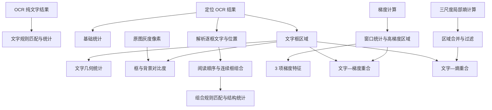
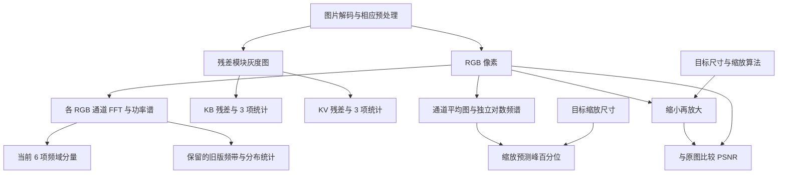

# 已实现图片特征提取与依赖关系清单

核对日期：2026年11月3日。依据项目当前提取入口、服务实现和配套文档整理。

## 一、整理范围

当前图片侧有 8 类独立提取入口，合计输出 62 项数值字段。其中包含置信度可用数量、动态阈值等辅助字段，不等于 62 个独立的攻击判断。

下文的“对应攻击方向”表示这些特征能够为哪些攻击提供候选线索，是结合实现内容和系统用途所作的归类；不代表各类特征已经独立验证为正式专属检测器，也不代表正常图片不会产生相似响应。具体模式仍需要配置并验证判断规则和阈值。

另有保留的旧版频域接口及第二步的 RCS 隐藏状态提取，分别列在后文，不混入上述 62 项。

## 二、提取方法、输出及对应攻击方向

为说明依赖，将同一 OCR 数值模块中的四组计算分别列出。

| 方法／计算组 | 如何提取、主要输出 | 对应攻击方向或用途 | 必须先取得什么 |
| --- | --- | --- | --- |
| OCR 基础统计（5 项） | 对识别文字和框进行计数，统计可用置信度 | 文字提示注入的基础描述；置信度字段用于说明 OCR 结果可用情况 | OCR 文字和框；置信度仅在输入提供时可用 |
| OCR 几何与对比度（5 项） | 统计文字框面积、高度、边缘位置，并比较框内像素与周围背景 | 低对比度文字、边缘或小区域文字注入；界面伪装的辅助布局线索 | OCR 框、图片尺寸；对比度还需要原图灰度像素 |
| 文字—梯度重合（3 项） | 文字区域与高梯度区域求交集、覆盖率和 IoU | 辅助分析文字载体与局部纹理异常的空间关系；可支持局部贴片、文字叠加等候选分析 | OCR 框＋梯度选中窗口形成的区域 |
| 文字—熵重合（3 项） | 文字区域与局部熵候选区域求交集、覆盖率和 IoU | 辅助分析高熵区域是否与文字区域重合，支持局部贴片等候选分析 | OCR 框＋三尺度局部熵合并过滤后的候选掩码 |
| 文字规则（6 项） | OCR 文本规范化后进行关键词、组合条件和正则匹配；统计五类命中行数及命中文字行占比 | 图片文字中的操作诱导、控制指令、链接及凭据请求等提示注入线索 | OCR 文字，不强制要求文字框 |
| 跨区域文字组合（5 项） | 解析逐框文字，按 XY Cut 排阅读顺序，组合连续框，检查新增规则命中，再统计框数和空间跨度 | 将指令拆分到多个文字区域的攻击 | 逐框对应的文字与位置、图片尺寸、阅读顺序、文字匹配规则 |
| 梯度（3 项） | 灰度图求梯度幅值、归一化，再做滑动窗口统计和阈值选择 | 局部扰动、纹理明显或边界突出的贴片线索 | 按该模块定义生成的灰度图；不需要 OCR |
| 局部熵（18 项） | 三种尺度分别计算窗口熵，生成高熵区域，再合并并过滤连通区域 | 局部高纹理贴片、局部异常区域线索 | 按该模块定义生成的灰度图；不需要梯度或 OCR |
| 频域（当前入口 6 项） | RGB 各通道分别做 FFT，取得功率谱，计算高低频功率比和熵替代项 | 全局像素扰动、频域分布异常的候选线索 | RGB 像素和各通道功率谱；不需要梯度或局部熵 |
| 残差（6 项） | 分别使用 KB 3×3、KV 5×5 滤波器，统计残差绝对值均值、标准差和能量 | 像素扰动及残差异常线索，可用于全局扰动候选分析 | 灰度图；不需要频域或梯度结果 |
| 缩放（2 项） | 一项检查与目标缩放尺寸相关的频谱峰；另一项比较缩小再放大后的 PSNR | 图像缩放攻击，即下游缩放后呈现内容异常的攻击线索 | 原图 RGB、目标缩放尺寸；重建比较还需要指定缩放算法 |

### 对几个攻击名称的补充说明

- **低对比度文字：** 当前已有文字框与背景对比度统计，但依赖文字首先被 OCR 定位；未在这 8 个入口中实现“增强前后 OCR 差异”的完整提取流程。
- **设备界面伪装：** 当前已有文字位置、大小、面积及文字规则等辅助信息，不能将其称为已经实现了界面控件、布局结构或界面真伪的专属识别。
- **局部贴片：** 梯度和熵分别反映不同的图像性质，正常文字和纹理也会响应。文字重合特征用于补充解释，不能因为区域含文字就排除攻击。
- **全局扰动：** 当前频域和残差是统计描述，不是经过训练的通用攻击分类器。梯度入口主要输出局部窗口汇总，不能写成已经完成了全部全局梯度分布分析。
- **文字规则：** 当前沿用英文匹配规则，纯中文不在其覆盖范围内；匹配成功不等于攻击成立。
- **缩放攻击：** 目标尺寸和缩放算法应与实际下游处理一致，代码默认 224×224、最近邻不代表目标模型实际使用这套设置。

## 三、必须满足的先后关系

这里的“先后”指数据依赖：后一步必须使用前一步的结果。多个前置结果之间通常没有固定先后，只要最终都已准备好即可。

| 要计算的内容 | 必须先完成的内容 | 说明 |
| --- | --- | --- |
| OCR 基础统计 | OCR 识别／导入与解析 | 需要文字和框记录 |
| 文字几何统计 | OCR 框定位、取得图片尺寸 | 面积、框高和边缘位置不依赖梯度或熵 |
| 框与背景对比度 | OCR 框定位、灰度图准备 | 不能只有纯文字 |
| 文字规则统计 | 取得 OCR 文本、规范化和规则匹配 | 不需要先执行全部 OCR 数值提取 |
| 跨框组合统计 | 取得逐框文字与位置 → 阅读排序 → 连续框组合匹配及去重 | 需要单框匹配基线，排除单框已经命中的类别 |
| 梯度统计及区域 | 灰度图 → 梯度幅值 → 归一化 → 窗口均值与选择 | 窗口结果是重合特征可复用的中间结果 |
| 单尺度局部熵特征 | 灰度图 → 窗口熵／热图 → 动态阈值及区域 | 三种尺度分别计算，不依赖上一个尺度的结果 |
| 合并后的局部熵区域统计 | 三个尺度的区域 → 合并 → 连通区域过滤 | 合并后的候选掩码供文字—熵重合使用 |
| 文字—梯度重合 | OCR 文字区域＋高梯度区域 | 两个输入都必需，OCR 与梯度谁先完成均可 |
| 文字—熵重合 | OCR 文字区域＋合并过滤后的高熵候选区域 | 不需要先算文字—梯度重合 |
| 当前 6 项频域特征 | RGB → 各通道 FFT → 功率谱 | 不依赖旧版频带统计或旧版综合分数 |
| KB／KV 残差统计 | 灰度图 → 对应滤波器残差 | KB 与 KV 互不依赖 |
| 缩放频谱峰百分位 | RGB 通道平均图 → FFT／对数频谱；目标尺寸 → 预测峰区域 | 当前实现使用独立频谱，不读取普通频域的 power.npy |
| 缩放重建 PSNR | RGB → 按目标尺寸缩小 → 放大回原尺寸 → 与原图比较 | 不需要先计算缩放频谱峰 |

### 关系图一：文字、梯度和熵的组合关系

图中展示结果之间的依赖，不表示 OCR 已经实现统一缓存，也不表示已有自动并行调度。

定位 OCR 结果在 OCR 数值和跨框模块中目前分别获取、缓存和解析；尤其跨框模块需要可靠的逐框文字关联，不能直接用数值模块的汇总文字和框列表代替。

### 关系图二：其他像素侧计算

图中的基础输入是逻辑上的共同来源。当前各服务仍有分别读取和解码图片的步骤，不能据此认为 RGB 或灰度数组已全部共享。

## 四、哪些关系不能误写成依赖

1. **梯度、局部熵、频域、残差互不从属。** 它们可以分别从图片取得输入，不需要先把其他几类提取完。无数据依赖不等于当前已经实现并行执行。
2. **共用存储类不等于需要先做频率提取。** 梯度、熵、残差、缩放和 OCR 数值模块继承 `FrequencyFeatureStore`，主要使用其存储基础设施，并不因此先运行 FFT。
3. **OCR 数值入口的执行顺序不是全部的必需先后关系。** 当前入口依次执行基础统计、几何统计、梯度重合和熵重合；几何不需要先拿到基础统计数值，熵重合也不依赖梯度重合结果。
4. **同样叫“熵”不代表能够互换。** 局部熵来自灰度窗口的像素分布，频域熵替代项来自频谱幅值分布，旧版谱熵又有自己的定义。
5. **同样使用 FFT 不代表当前频谱可以直接复用。** 普通频域保存各 RGB 通道的功率；缩放峰检测使用通道平均图的对数幅值谱。仅有各通道功率不能直接替代后者。
6. **共用文字规则函数不等于共用已经算好的统计。** 跨框模块复用 SnapGuard 匹配代码，但仍需对单框和组合文字分别检查；整页五类命中次数不能替代跨框分析。
7. **同为灰度图也需核对定义。** 梯度和 OCR 对比度使用 Pillow 灰度并归一到 0～1；残差使用 Pillow 灰度的 0～255 数值；局部熵使用另一套加权与舍入方式。共享时应保留各自数值定义。

## 五、已经实现的复用与尚未打通的部分

| 关系 | 当前状态 |
| --- | --- |
| 梯度窗口 → OCR 的文字—梯度重合 | 已实现：调用梯度服务，已有结果时复用 windows.npz；重合模块据选中窗口重建区域 |
| 局部熵区域 → OCR 的文字—熵重合 | 已实现：读取 candidate_mask.npy；熵服务可复用各尺度结果，但再次调用仍进行合并过滤 |
| RGB 功率谱 → 多种频域输出 | 已实现：共享 power.npy；当前 6 项分量不必先计算旧版 45 项统计 |
| 数值特征与图像内容关联缓存 | 多个模块共用 features.sqlite3，并用各自配置／分组区分结果 |
| 三个文字模块统一使用一次 OCR | 尚未打通：数值模块、文字规则模块、跨框模块的缓存结构和输入要求不同 |
| 原始结构化 OCR → 数值统计与跨框组合 | 可在输入一致时通过已有参数分别导入同一原始结果，自动跨模块读取尚未统一 |
| 所有模块共享一次图片解码／灰度计算 | 尚未统一，当前有分别解码与转换步骤 |
| 共享残差图、缩放频谱或重建图片供其他模块使用 | 当前主要保存最终统计，不应描述为已建立这些跨模块中间结果缓存 |

文字规则默认请求 `free_ocr / tiny`；OCR 数值和跨框模块默认请求 `markdown / gundam`。后两者虽然请求设置相同，仍分别管理缓存。后续统一时需要保留逐框关联并确认配置适用，不能只按“做过 OCR”就默认全部可复用。

## 六、当前 62 项输出字段

以下字段以当前独立提取入口为准，便于与代码核对。缺失值不是零；例如 OCR 没有提供置信度时，均值和最小值为缺失。

### 1. OCR 数值：16 项

| 组别 | 字段及含义 |
| --- | --- |
| 基础统计，5 项 | `character_count` 非空白字符数；`text_box_count` 文字框数；`confidence_available_count` 有置信度框数；`confidence_mean` 置信度均值；`confidence_min` 最小置信度 |
| 几何／对比度，5 项 | `text_area_ratio` 文字框并集面积占比；`relative_box_height_mean`、`relative_box_height_max` 相对框高均值／最大值；`edge_text_box_ratio` 边缘文字框比例；`box_background_contrast_mean` 框与周围背景的对比度代理值 |
| 梯度重合，3 项 | `gradient_text_coverage` 重合面积／文字面积；`gradient_response_in_text_ratio` 重合面积／高梯度区域面积；`gradient_iou` 两区域交并比 |
| 熵重合，3 项 | `entropy_text_coverage` 重合面积／文字面积；`entropy_response_in_text_ratio` 重合面积／高熵候选区域面积；`entropy_iou` 两区域交并比 |

DeepSeek 当前定位输出没有置信度；其文字框通常是版面块，框高不等于字体大小。对比度值不是精确的文字前景与背景对比度，也可能受框内图案影响。

### 2. 文字规则：6 项

`position_click_count` 点击诱导命中行数；`password_input_count` 密码输入命中行数；`link_invitation_count` 链接邀请命中行数；`control_instruction_count` 控制指令命中行数；`credential_request_count` 凭据请求命中行数；`matched_text_ratio` 命中文字行占全文的长度比例。

统计的是符合规则的行，不是全部恶意语义，也不是恶意短语的精确字符覆盖率。

### 3. 跨区域文字组合：5 项

`cross_box_match_count` 跨框新增类别命中数；`mean_combination_box_count` 命中片段平均框数；`max_combination_box_count` 最大片段框数；`mean_box_gap_normalized` 平均相邻框距离；`max_spatial_span_normalized` 最大空间跨度。

默认分析阅读顺序中连续 2～4 个框，窗口上限可配置。同一类别若已经在其中一个单框命中，则不计为新增跨框命中。复杂阅读顺序、非连续碎片或规则外表达不保证覆盖。

### 4. 梯度：3 项

`max_window_gradient` 最大窗口平均归一化梯度；`high_gradient_window_ratio` 高梯度窗口比例；`high_gradient_area_ratio` 高梯度窗口并集面积比例。

采用 LGS 思路：15×15 窗口、步长 10，以窗口均值大于 0.1 选择区域。这个区域选择阈值不是已经验证的攻击判定阈值。

### 5. 局部熵：18 项

`scale_1_`、`scale_2_`、`scale_3_` 三个前缀，各包含 `entropy_mean`、`entropy_std`、`entropy_max`、`threshold`、`high_entropy_area_ratio`，合计 15 项。

合并过滤后另有 `candidate_area_ratio` 候选面积比例、`candidate_region_count` 候选区域数、`largest_candidate_area_ratio` 最大区域面积比例，共 3 项。代码移植 Jedi 的窗口熵与候选区域部分，不运行其自编码器或图像修复。

### 6. 频域：6 项

`red_de_five_`、`green_de_five_`、`blue_de_five_` 三个前缀，各包含 `high_low_ratio` 高低频功率比与 `entropy_surrogate` 幅值分布熵替代项，共 6 项。当前入口不输出合并后的攻击分数，也不平均 RGB 三个通道。

### 7. 残差：6 项

`kb_`、`kv_` 两个前缀，各包含 `residual_mean_abs` 残差绝对值均值、`residual_std` 残差标准差、`residual_energy` 残差平方均值，共 6 项。

代码使用 SRM 的 KB／KV 线性残差计算，并未实现完整高维 SRM 共生特征与分类器。残差图未作为大体积中间文件保存。

### 8. 缩放：2 项

`peak_spectrum_percentile` 预测峰窗口强度在整幅对数频谱中的百分位；`down_up_psnr_db` 缩小再放大后的重建 PSNR。两项相互独立，不是先算频谱才能计算 PSNR。

## 七、保留接口与第二步提取

### 保留的旧版频域能力

`FrequencyFeatureStore.extract()`／`extract_bytes()` 仍支持 `bands` 和 `statistics` 两组，共 45 项数值，即每个 RGB 通道 15 项：

- `ac_energy`；`low_energy`、`mid_energy`、`high_energy`；`low_ratio`、`mid_ratio`、`high_ratio`。
- `total_energy`、`dc_energy_ratio`、`centroid`、`bandwidth`、`entropy_normalized`、`peak_energy_ratio`、`radius_q50`、`radius_q90`。

服务还保留 `extract_de_five()` 的组合分数接口，当前命令行不调用。上述能力共用频谱基础，不是新的独立攻击类别；也不代表这些保留字段已经全部纳入当前特征向量。

### RCS 隐藏状态提取

项目另有 `backend/rcs_features.py`：图片和任务问题一起经过目标 Qwen 模型前向，提取所选层最后有效输入 token 的隐藏向量。当前实现使用一次完整输入前向取得所选层向量，并不因为只保存一个层就自动在该层停止前向。

其计算链是“图片＋任务问题 → 模型预处理 → 目标模型前向 → 隐藏向量 → 后续投影与参考比较”。它属于第二步，不依赖先取得上面的 OCR、梯度或频域手工特征，不计入图片侧 62 项输出。

## 八、代码位置

| 入口 | 主要实现 |
| --- | --- |
| [extract_ocr_features.py](D:/CodexProjects/PrivaSee/backend/extract_ocr_features.py) | [ocr_numeric_features.py](D:/CodexProjects/PrivaSee/backend/services/ocr_numeric_features.py:78) |
| [extract_text_rules.py](D:/CodexProjects/PrivaSee/backend/extract_text_rules.py) | [text_rule_features.py](D:/CodexProjects/PrivaSee/backend/services/text_rule_features.py:24) |
| [extract_distributed_text.py](D:/CodexProjects/PrivaSee/backend/extract_distributed_text.py) | [distributed_text_features.py](D:/CodexProjects/PrivaSee/backend/services/distributed_text_features.py:121) |
| [extract_gradient.py](D:/CodexProjects/PrivaSee/backend/extract_gradient.py) | [gradient_features.py](D:/CodexProjects/PrivaSee/backend/services/gradient_features.py:36) |
| [extract_entropy.py](D:/CodexProjects/PrivaSee/backend/extract_entropy.py) | [entropy_features.py](D:/CodexProjects/PrivaSee/backend/services/entropy_features.py:42) |
| [extract_frequency.py](D:/CodexProjects/PrivaSee/backend/extract_frequency.py) | [frequency_features.py](D:/CodexProjects/PrivaSee/backend/services/frequency_features.py:150) |
| [extract_residual.py](D:/CodexProjects/PrivaSee/backend/extract_residual.py) | [residual_features.py](D:/CodexProjects/PrivaSee/backend/services/residual_features.py:39) |
| [extract_scaling.py](D:/CodexProjects/PrivaSee/backend/extract_scaling.py) | [scaling_features.py](D:/CodexProjects/PrivaSee/backend/services/scaling_features.py:23) |
| 第二步 [rcs_features.py](D:/CodexProjects/PrivaSee/backend/rcs_features.py:104) | [现有提取与投影说明](D:/CodexProjects/PrivaSee/docs/rcs_feature_projection.md) |

本次为静态代码核对与文档整理，未重新运行 OCR、模型前向或攻击检出率实验，也未修改提取代码。
